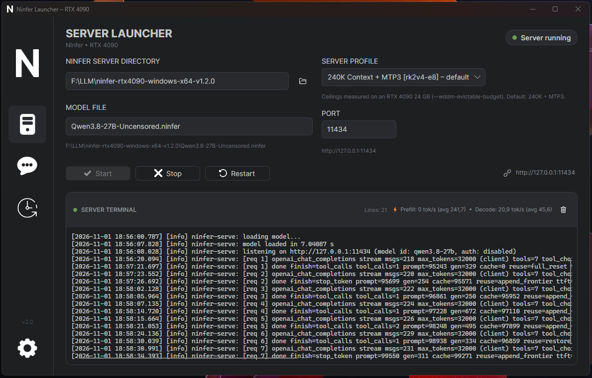

# Ninfer Launcher v2

Desktop launcher for the **Ninfer** local inference server, tuned for **NVIDIA RTX 4090 (24 GB)**.
It is a graphical front-end (replacement for `runnerbat` / `RunNinfer.bat`) that starts
`ninfer-serve.exe` / `ninfer_bench.exe` with pre-tuned profile flags and shows a live
terminal with the throughput (prefill / decode tok/s).

Built with **Avalonia UI 12** + **CommunityToolkit.Mvvm**, targeting **.NET 10** (Windows).

## Preview



## Features

- One-click start / stop / restart of the Ninfer server.
- Profile dropdown with colour-coded groups – pick a profile, the right
  binary / flags are picked for you:
  - <span style="color:#6A9955">green – Recommended and tested</span> (daily drivers),
  - <span style="color:#C8A24B">amber – Usable and tested</span> (fast, low-VRAM),
  - <span style="color:#569CD6">blue – Benchmarks</span> (run via `ninfer_bench.exe`),
  - <span style="color:#A54242">red – Not tested / not working</span> (known limits, low VRAM).
- Live terminal with noisy-log filtering, a prefill/decode tok/s readout and
  **select-and-copy**: individual log lines can be selected with the mouse and copied,
  and a **Copy all** button (in the terminal header) copies the whole log to the clipboard.
- Chat page: message bubbles render Markdown (headings, code blocks, tables, links);
  message text is selectable – drag to highlight, `Ctrl+C` copies it as plain text.
  Bubbles are rendered by the Simplecto `AvRichTextBox` control, built from the vendored
  source in `../.api-test/avrsrc/AvRichTextBox` (project reference; its test suite lives
  in `../.api-test/avrsrc` as well).
- Live configuration (server dir, model file, port) persisted to a local
  `settings.json` file next to the exe (falls back to
  `%AppData%\NinferLauncher\settings.json` if the exe's folder is not writable).

## Requirements

| Dependency | Details |
| --- | --- |
| **Ninfer server** | `ninfer-rtx4090-windows-x64-v1.2.0` from <https://github.com/UDPSendToFailed/ninfer-4090> |
| **Model** | `Qwen3.8-27B-Uncensored.ninfer` |
| **GPU** | NVIDIA RTX 4090 (24 GB) with the latest driver / CUDA runtime the server requires |
| **OS** | Windows 10 / 11 |

> The launcher is only the **launcher** – it does **not** bundle the Ninfer server or the
> model. You have to install both separately (see below) and point the launcher at them.

## Installation

### 1. Get the Ninfer server

Download and extract
[`ninfer-rtx4090-windows-x64-v1.2.0`](https://github.com/UDPSendToFailed/ninfer-4090) to a
folder on your machine, for example:

```
F:\LLM\ninfer-rtx4090-windows-x64-v1.2.0\
    ├── ninfer-serve.exe
    ├── ninfer_bench.exe
    └── ...
```

### 2. Get the model

Download `Qwen3.8-27B-Uncensored.ninfer` and place it inside the same folder, e.g.:

```
F:\LLM\ninfer-rtx4090-windows-x64-v1.2.0\Qwen3.8-27B-Uncensored.ninfer
```

### 3. Build & run the launcher

Prerequisites: the [.NET 10 SDK](https://dotnet.microsoft.com/download) (the project targets
`net10.0`).

```powershell
# from the project folder (the one containing the .sln / .csproj)
dotnet restore
dotnet run -c Release
```

Or build a standalone executable:

```powershell
dotnet publish -c Release -r win-x64 --self-contained false -o out
```

### 4. Point the launcher at your setup

In the app's **Settings** screen set:

| Field | Value |
| --- | --- |
| **Server directory** | `F:\LLM\ninfer-rtx4090-windows-x64-v1.2.0` |
| **Model file** | `Qwen3.8-27B-Uncensored.ninfer` |
| **Port** | `11434` (default) |

The defaults above are already baked in as defaults
(`Models/ServerSettings.cs`), so if you installed to that path nothing else to configure.

## Profiles

Profiles are defined in `Models/ServerSettings.cs` (`ServerProfiles`) and documented in
[`CustomProfiles.txt`](CustomProfiles.txt). Each profile is a combination of:

- context length (`--max-context` / `--kv-capacity`),
- MTP speculation (`--spec mtp --draft-tokens N --lm-head-draft`),
- KV cache dtype (`rk2v4-e8`, `rk4v4-e8`, `rk4v4`, `rk8v4`, `int8`),
- vision mode (none / 4k / 8k), and a fixed set of runtime flags
  (`--preserve-thinking`, `--max-concurrency 1`, ...).
- `--wddm-evictable-budget` is optional – a checkbox on the server page adds it
  at startup when ticked (recommended on Windows: the driver can reclaim evictable
  VRAM pages under pressure instead of the server failing).

**Notes for Windows (WDDM):**

- Contexts above ~240k tokens may not work under WDDM; the launcher prints a warning for
  profiles over 240k.
- Bench profiles run `ninfer_bench.exe` with the prefill at the profile's context plus a
  128-token decode (tg128), using `<serverDir>\bench\fixtures\bench_corpus.ids` as corpus.

### Current profile set

| Group | Profile | Context | MTP | KV dtype | Notes |
| --- | --- | --- | --- | --- | --- |
| 🟢 Recommended | Agent – 240K + MTP3 | 245 760 | 3 | rk2v4-e8 (2-bit) | vision 4k, default start |
| 🟢 Recommended | Text – 64K + MTP4 | 65 536 | 4 | rk2v4-e8 | text-only default |
| 🟡 Usable | Fast 16K / 32K / 128K (2-bit) · Fast 64K (int8) | 16 384 – 131 072 | 4 | rk2v4-e8 / int8 | low-VRAM, high tok/s |
| 🔵 Bench | Bench 16K / 32K / 64K (MTP4), Bench 240K (MTP3) | 16 384 – 245 760 | 3–4 | rk2v4-e8 | runs `ninfer_bench.exe` |
| 🔴 Untested | Text 128K–48K / 40K, MTP0 · MTP4 | 40 960 – 131 072 | 0 / 4 | all 5 dtypes | lowered for ~3 GB VRAM budget |
| 🔴 Untested | Vision8k 96K / 76K / 36K | 36 864 – 98 304 | 4 | rk2v4-e8 / rk4v4-e8 / int8 | 8192 vision tokens |
| 🔴 Untested | Vision4k 100K / 80K | 81 920 – 102 400 | 4 | rk2v4-e8 / rk4v4-e8 | 4096 vision tokens |

Red-group contexts were lowered from the original 240k–500k set so the KV-cache
footprint stays around **3 GB**; verify them on your card and promote a profile to a
higher group once measured.

## License

Released under the [MIT License](LICENSE) – free to use, modify and distribute.

## Custom profiles

Profiles are **not hard-coded** – they live in `profiles.json` next to the exe
(created automatically on first run). Edit it in any text editor and restart the
launcher to add, remove or reorder entries:

```jsonc
{
  "profiles": [
    {
      "name": "My 100K profile",        // shown in the dropdown
      "group": "recommended",           // recommended | usable | bench | untested (dropdown section)
      "maxContext": 100000,             // tokens (also passed as --max-context / --kv-capacity)
      "kvDtype": "rk2v4-e8",            // bf16 | int8 | rk2v4-e8 | rk4v4-e8 | rk4v4 | rk8v4
      "mtpSpec": true,                  // MTP speculation on/off (false = MTP0)
      "draftTokens": 4,                 // draft tokens per step (used when mtpSpec is true)
      "vision": "none",                 // none | tokens4096 | tokens8192
      "isBench": false,                 // true → runs ninfer_bench.exe
      "note": "optional comment for yourself"
    }
  ]
}
```

- Malformed entries are skipped, an invalid file falls back to the built-in profiles – the app never crashes on a typo.
- Key casing is case-insensitive; unknown keys are ignored.

## Project layout

```
├── App.axaml / App.axaml.cs      # Avalonia app entry + global styles
├── Program.cs                    # Main / BuildAvaloniaApp
├── ViewLocator.cs                # ViewModel → View mapping
├── profiles.json                 # user-editable server profiles (next to the exe)
├── Models/
│   └── ServerSettings.cs         # settings/profile models + profiles.json loader
├── Services/
│   ├── ServerService.cs          # process start/stop, stdout capture
│   ├── LogFilter.cs              # terminal log filtering / tok/s parsing
│   └── SettingsStore.cs          # local settings.json next to the exe
├── ViewModels/                   # MVVM view models
├── Views/                        # .axaml views
├── Assets/                        # embedded icons / assets
```

## Troubleshooting

- **"Adresář serveru neexistuje" / "Model nenalezen"** – fix the server directory / model
  path in Settings to the real location of the Ninfer folder and model file.
- **Port in use** – change the port in Settings or stop other processes bound to it.
- **`--wddm-evictable-budget` unknown / "unknown option" at startup** – untick the
  `--wddm-evictable-budget` checkbox on the server page; older builds do not know the flag.
  Newer builds benefit from it under VRAM pressure (WDDM).
- **Server starts but no response** – for high-context (>240k) profiles fall back to a
  smaller context profile; on WDDM very large contexts can fail to bind.